# Compte rendu du TP : Mise en place du protocole SSH

| | |
|---|---|
| **Établissement** | DGI-ESP / UCAD |
| **Classe** | L3 GLSI |
| **Module** | Services Réseaux Avancés |
| **Année** | 2026-2027 |
| **Professeur** | Dr. Kéba GUEYE |
| **Réalisé par** | Khady Diaw |

## Sommaire

1. [Introduction](#introduction)
2. [Environnement de travail](#environnement-de-travail)
3. [Étape 1 : installation du serveur SSH](#étape-1--installation-du-serveur-ssh)
4. [Étape 2 : connexion SSH par mot de passe](#étape-2--connexion-ssh-par-mot-de-passe)
5. [Étape 3 : configuration des clés SSH](#étape-3--configuration-des-clés-ssh)
6. [Étape 4 : tunnel SSH avec MariaDB](#étape-4--tunnel-ssh-avec-mariadb)
7. [Problèmes rencontrés](#problèmes-rencontrés)
8. [Conclusion](#conclusion)

---

## Introduction

L'objectif de ce TP est d'apprendre à **administrer une machine à distance de façon sécurisée** avec SSH (Secure Shell). SSH permet d'ouvrir un terminal sur une autre machine à travers le réseau, et tout ce qui passe entre les deux machines est **chiffré**. Il utilise par défaut le **port 22**.

Le TP se déroule en quatre étapes, de la plus simple à la plus avancée : installer un serveur SSH, s'y connecter avec un mot de passe, se connecter avec des clés (sans mot de passe), puis créer un tunnel SSH pour protéger un service qui n'est pas chiffré.

## Environnement de travail

Le TP a été réalisé sur un seul ordinateur physique sous Windows, avec deux machines virtuelles créées dans VirtualBox.

| Rôle | Machine | Utilisateur | Adresse IP |
|---|---|---|---|
| Serveur SSH | Ubuntu 24.04 (Desktop) | `khadyja` | 192.168.1.10 |
| Client Linux | Debian 13 (sans interface graphique) | `khady` | 192.168.1.13 |
| Client Windows | Windows 11 (machine hôte) | `HP` | 192.168.1.7 |

Les deux machines virtuelles sont en mode réseau **« Accès par pont »** : elles sont branchées directement sur le réseau Wi-Fi, comme de vrais ordinateurs, et reçoivent leur propre adresse IP. En mode NAT (le réglage par défaut), Windows ne pourrait pas les joindre.

---

## Étape 1 : installation du serveur SSH

**Objectif.** Transformer la machine Ubuntu en serveur SSH, c'est-à-dire une machine qui accepte les connexions à distance. Par défaut, Ubuntu n'accepte aucune connexion SSH : il faut installer un programme qui reste allumé en permanence et attend les connexions (le service `sshd`).

**Commandes utilisées.**

```bash
sudo apt update                     # met à jour la liste des logiciels disponibles
sudo apt install openssh-server     # installe le serveur SSH
sudo systemctl enable ssh           # lance SSH automatiquement à chaque démarrage
sudo systemctl start ssh            # démarre SSH immédiatement
sudo systemctl status ssh           # affiche l'état du service
```

`sudo` exécute la commande en tant qu'administrateur, `apt` est le gestionnaire de paquets d'Ubuntu et `systemctl` est l'outil qui gère les services. `enable` prépare les prochains démarrages, alors que `start` agit tout de suite.

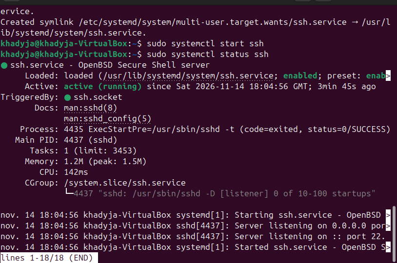

*Figure 1 : le service SSH est actif (`active (running)`) et écoute sur le port 22.*

**Vérification du port 22.** La commande `netstat` n'est plus installée par défaut sur Ubuntu 24.04 ; elle se trouve dans le paquet `net-tools`.

```bash
sudo apt install net-tools
sudo netstat -anp | grep -w 22
```

`netstat -anp` affiche toutes les connexions réseau avec leur port et leur programme. Le symbole `|` envoie ce résultat à `grep`, qui ne garde que les lignes contenant le mot 22.

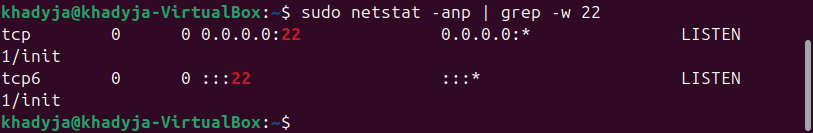

*Figure 2 : le port 22 est à l'état `LISTEN` en IPv4 et en IPv6.*

`LISTEN` signifie que le port est ouvert et attend des connexions. Contrairement à l'énoncé, le programme affiché est `1/init` et non `sshd` : sur Ubuntu 24.04, c'est systemd (le processus numéro 1) qui surveille le port 22 et réveille SSH quand une connexion arrive.

---

## Étape 2 : connexion SSH par mot de passe

**Objectif.** Se connecter au serveur depuis un client avec `ssh utilisateur@adresse_ip`. Cette étape prouve que le serveur répond et que le réseau fonctionne entre les deux machines.

**Adresse du serveur.** Elle a été obtenue sur Ubuntu avec la commande `ip a`, qui affiche les cartes réseau et leurs adresses. Sur la carte `enp0s3`, la ligne `inet` indique **192.168.1.10**.

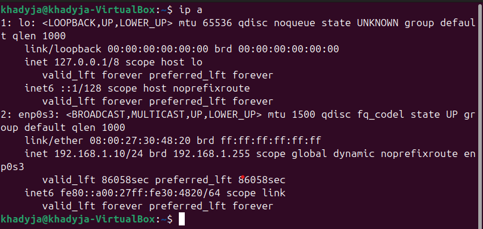

*Figure 3 : adresse IP du serveur Ubuntu.*

**Connexion depuis Windows.** Windows dispose d'un client SSH intégré, utilisable dans l'invite de commandes :

```bash
ssh khadyja@192.168.1.10
```

Lors de la première connexion, SSH affiche l'**empreinte** du serveur et demande si on lui fait confiance. Après la réponse `yes`, Windows enregistre ce serveur dans le fichier `known_hosts` ; il pourra ainsi détecter si un autre serveur essaie un jour de se faire passer pour lui. Après la saisie du mot de passe d'Ubuntu, la connexion est établie : la fenêtre de Windows devient un terminal du serveur.

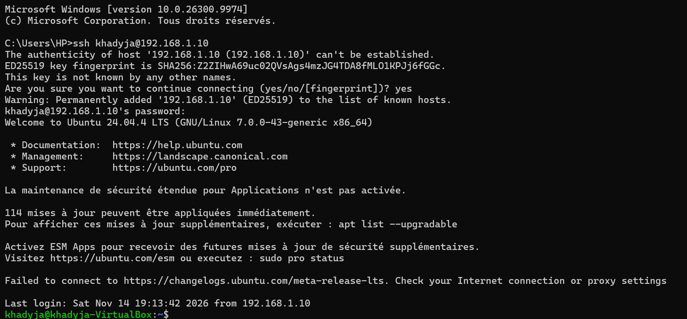

*Figure 4 : connexion SSH du client Windows vers le serveur Ubuntu.*

**Limite de cette méthode.** Un mot de passe peut être deviné ou volé. C'est pour cela que l'étape suivante le remplace par des clés.

---

## Étape 3 : configuration des clés SSH

**Principe.** L'authentification par clés repose sur le chiffrement asymétrique. On crée une paire de clés :

- la **clé publique**, qui joue le rôle d'un cadenas : elle n'est pas secrète et se dépose sur la machine où l'on veut entrer ;
- la **clé privée**, la seule qui ouvre ce cadenas : elle reste toujours sur la machine de celui qui se connecte et ne voyage jamais sur le réseau.

À chaque connexion, la machine qui reçoit la connexion lance un défi que seule la clé privée sait résoudre. Dans ce TP, c'est Ubuntu qui crée les clés et qui se connecte au client Debian : pendant cette étape, Ubuntu joue donc le rôle de client SSH, et Debian celui de serveur.

### 3.1 Génération de la paire de clés (sur Ubuntu)

```bash
ssh-keygen -t rsa
```

J'ai laissé l'emplacement par défaut et je n'ai pas défini de phrase de passe (*passphrase*), afin que la connexion soit entièrement automatique.

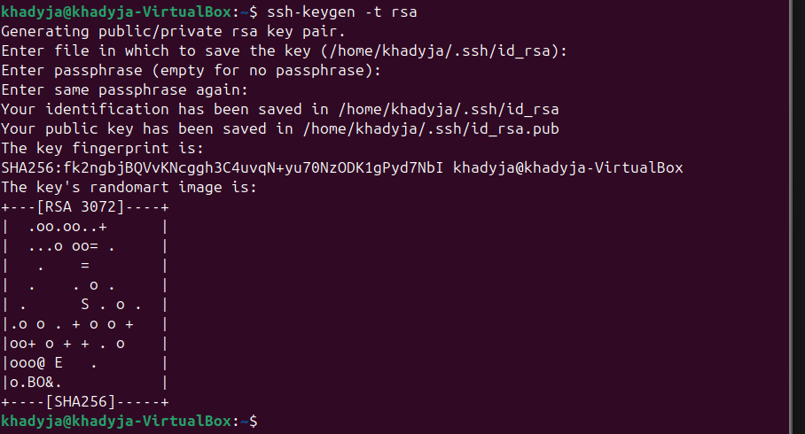

*Figure 5 : génération d'une paire de clés RSA de 3072 bits.*

La clé privée est enregistrée dans `~/.ssh/id_rsa` et la clé publique dans `~/.ssh/id_rsa.pub`. Le dossier `.ssh` commence par un point, ce qui en fait un dossier caché : il n'apparaît qu'avec `ls -a`.

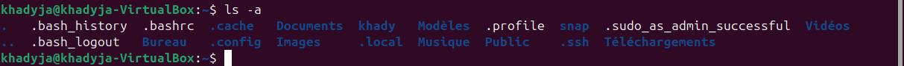

*Figure 6 : le dossier caché `.ssh` apparaît avec `ls -a`.*

### 3.2 Copie de la clé publique vers le client Debian

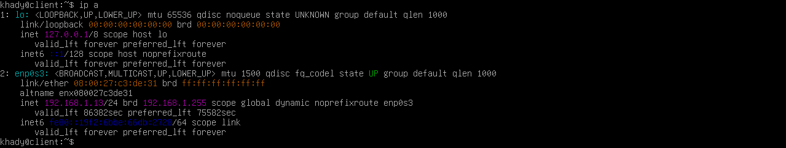

*Figure 7 : adresse IP du client Debian (192.168.1.13).*

Depuis Ubuntu, la clé publique est envoyée dans le dossier personnel de l'utilisateur `khady` sur Debian :

```bash
scp ~/.ssh/id_rsa.pub khady@192.168.1.13:/home/khady
```

`scp` (*Secure Copy*) copie un fichier vers une autre machine à travers SSH, donc de façon chiffrée. Le mot de passe demandé est celui de `khady` sur Debian, puisque les clés ne sont pas encore en place.

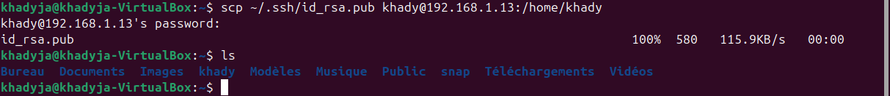

*Figure 8 : la clé publique est copiée à 100 %.*

### 3.3 Ajout de la clé dans `authorized_keys` (sur Debian)

**Cette étape n'apparaît pas dans l'énoncé, mais elle est indispensable.** Le serveur SSH ne cherche pas les clés n'importe où : il lit uniquement le fichier `~/.ssh/authorized_keys`, la liste des clés autorisées. Sans cette étape, le mot de passe est toujours demandé.

```bash
mkdir -p ~/.ssh                              # crée le dossier .ssh s'il n'existe pas
cat id_rsa.pub >> ~/.ssh/authorized_keys     # ajoute la clé à la liste des clés autorisées
```

`cat` lit le contenu de la clé et `>>` l'ajoute à la fin du fichier, en le créant s'il n'existe pas. Avec un seul `>`, le fichier serait écrasé.

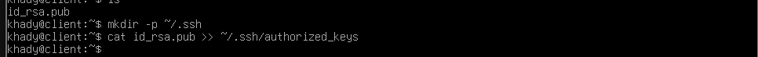

*Figure 9 : la clé reçue est ajoutée au fichier `authorized_keys`.*

### 3.4 Test de connexion sans mot de passe

```bash
ssh khady@192.168.1.13
```

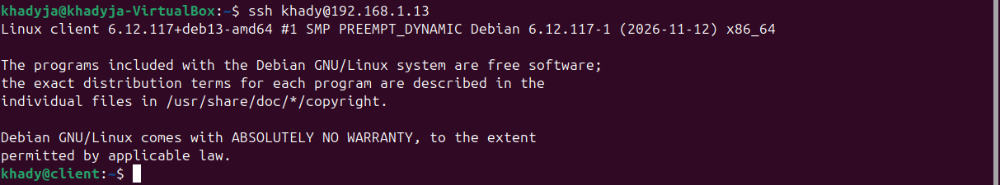

*Figure 10 : connexion d'Ubuntu vers Debian sans mot de passe.*

Aucun mot de passe n'est demandé et l'invite devient `khady@client` : Debian a reconnu Ubuntu grâce à sa clé. L'authentification par clés fonctionne.

---

## Étape 4 : tunnel SSH avec MariaDB

**Principe.** Un tunnel SSH fait passer les échanges d'un autre service à l'intérieur de la connexion SSH, qui est chiffrée. Il protège ainsi un service qui ne l'est pas, et seul le port 22 doit être ouvert sur le serveur. J'ai choisi de tester le tunnel avec une base de données **MariaDB** (port 3306), qui envoie ses données en clair.

### 4.1 Mise en place de MariaDB (sur Ubuntu)

```bash
sudo apt install mariadb-server
sudo systemctl status mariadb
```

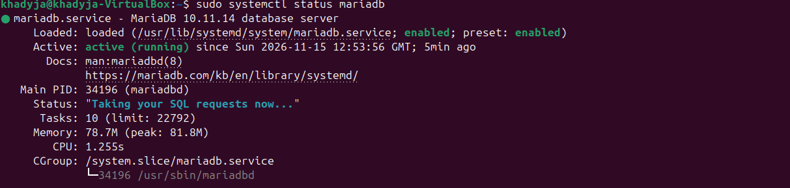

*Figure 11 : le service MariaDB est actif.*

Dans les messages de démarrage, on remarque que MariaDB n'écoute que sur l'adresse **127.0.0.1**, c'est-à-dire la machine elle-même : il n'est donc pas joignable depuis le réseau. C'est exactement ce qui rend le tunnel utile.

Dans la console MariaDB (`sudo mariadb`), j'ai créé une base de test et un utilisateur qui ne peut se connecter que depuis le serveur lui-même :

```sql
CREATE DATABASE tpssh;
CREATE USER 'khady'@'localhost' IDENTIFIED BY '********';
GRANT ALL PRIVILEGES ON tpssh.* TO 'khady'@'localhost';
```

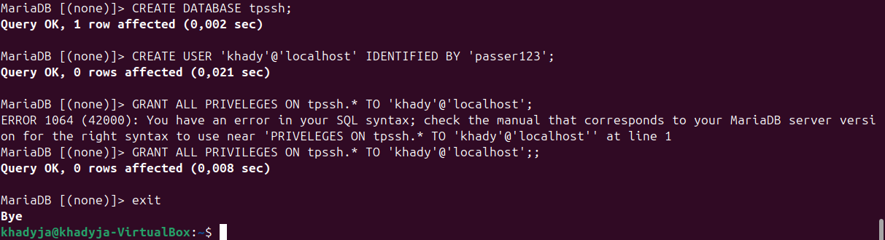

*Figure 12 : création de la base `tpssh` et de l'utilisateur `khady`. L'erreur 1064 vient d'une faute de frappe (`PRIVELEGES`), corrigée à la ligne suivante.*

### 4.2 Création du tunnel (sur Windows)

```bash
ssh -L 3307:127.0.0.1:3306 khadyja@192.168.1.10
```

- `-L` crée une redirection de port locale (le tunnel) ;
- `3307` est l'**entrée** du tunnel, sur Windows. Le port 3306 était déjà utilisé par MySQL sur Windows, d'où le choix de 3307 au lieu du port 1024 de l'énoncé ;
- `127.0.0.1:3306` est la **sortie** du tunnel, vue depuis le serveur : MariaDB.

Tout ce qui entre par le port 3307 de Windows ressort donc sur le port 3306 du serveur, à travers SSH. Cette fenêtre doit rester ouverte pendant tout le test, car c'est elle qui maintient le tunnel.

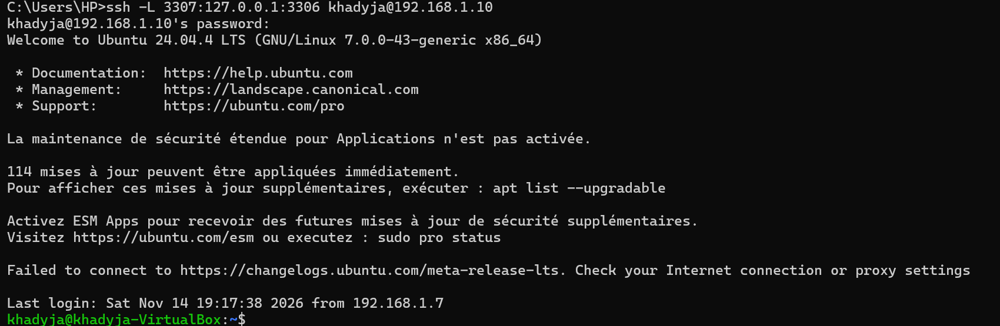

*Figure 13 : ouverture du tunnel SSH depuis Windows.*

### 4.3 Test à travers le tunnel (sur Windows)

Dans une deuxième fenêtre (PowerShell), j'ai utilisé le client MySQL déjà installé sur Windows. Comme PowerShell ne connaissait pas son emplacement, il a fallu indiquer son chemin complet, précédé de `&` qui demande à PowerShell de l'exécuter :

```powershell
& "C:\Program Files\MySQL\MySQL Server 8.0\bin\mysql.exe" -h 127.0.0.1 -P 3307 -u khady -p
```

Puis, dans la console :

```sql
SHOW DATABASES;
```

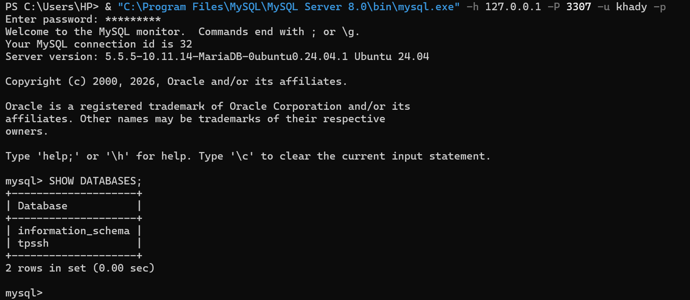

*Figure 14 : accès à MariaDB depuis Windows à travers le tunnel.*

La connexion vise **127.0.0.1**, c'est-à-dire Windows lui-même, et c'est pourtant le **MariaDB d'Ubuntu** qui répond : la version affichée contient `MariaDB` et `Ubuntu 24.04`, et la base `tpssh` créée sur le serveur apparaît. Les échanges sont donc bien passés à travers le tunnel SSH chiffré.

---

## Problèmes rencontrés

| Problème | Cause | Solution |
|---|---|---|
| Le mot de passe était encore demandé après l'envoi de la clé | La clé n'était pas dans `authorized_keys` | `cat id_rsa.pub >> ~/.ssh/authorized_keys` sur le client |
| `Permission denied` avec `scp` | Majuscule mal saisie (Caps Lock inefficace dans la VM) | Utiliser la touche Maj (Shift) |
| Windows ne pouvait pas joindre la VM | Réseau de la VM en mode NAT | Passer en « Accès par pont » |
| `Can't connect to server on '127.0.0.1'` | Commande tapée dans la fenêtre déjà connectée au serveur | Ouvrir une nouvelle fenêtre Windows |
| `mysql` n'est pas reconnu | Windows ne connaît pas l'emplacement de MySQL | Donner le chemin complet avec `&` dans PowerShell |
| Port 3306 indisponible sur Windows | Déjà utilisé par MySQL | Utiliser le port 3307 comme entrée du tunnel |
| Erreur SQL 1064 | Faute de frappe : `PRIVELEGES` | Corriger en `PRIVILEGES` |

## Conclusion

Ce TP m'a permis de mettre en place un serveur SSH et de m'y connecter depuis différents clients. J'ai compris la différence entre l'authentification par mot de passe et l'authentification par clés, plus sûre, car la clé privée ne quitte jamais la machine de celui qui se connecte. J'ai aussi constaté que la clé publique doit être placée dans le fichier `authorized_keys` pour que la connexion sans mot de passe fonctionne. Enfin, le tunnel SSH m'a montré comment protéger un service non chiffré, comme une base de données, en faisant passer ses échanges à l'intérieur de SSH, tout en n'ouvrant que le port 22 sur le serveur.
